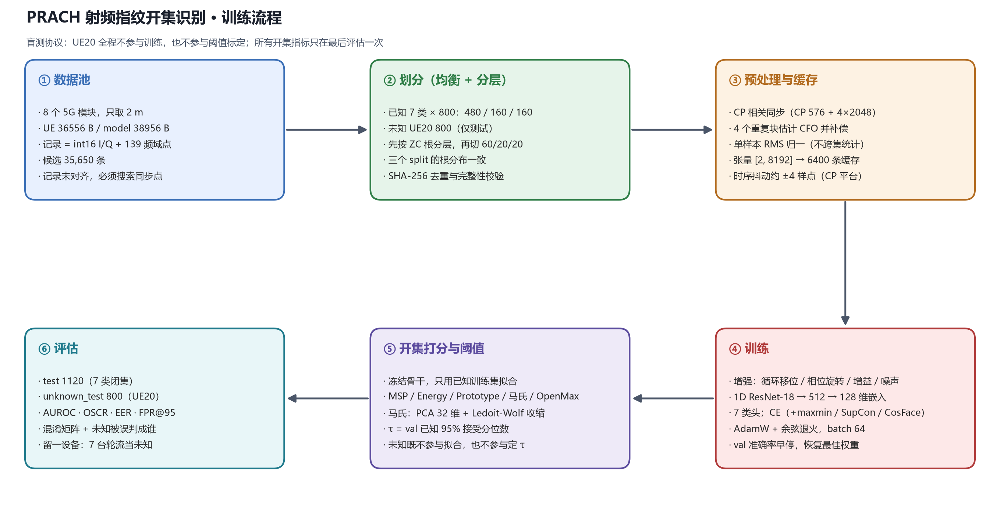

# 5G PRACH 射频指纹开集识别 · 实验流程设计

> 数据：`data/` 下 8 个 5G 模块的 NR PRACH 采集；已知 7 类，`UE20` 作为未知类。
> 代码：`analysis/`；产物：`outputs/`；划分清单：`data/splits/open_set_2m_balanced_seed42/`。



---

## 1. 任务定义

开集识别（OSR）要同时回答两个问题：

1. 这条前导是否来自**已知**设备？（拒识 / 二分类）
2. 如果是，是**哪一台**？（7 分类）

与闭集分类的区别在于：`UE20` 的样本在训练期完全不可见，也**不参与任何阈值标定**。
因此本流程的所有数字都来自"训练时没见过 UE20"的盲测。

### 1.1 数据与物理层

每个 `.bin` 是一条 int16 小端交织 I/Q 记录：

| 采集家族 | 记录长度 | 时域点数 | 尾部频域点 |
|---|---:|---:|---:|
| UE9 / UE12 / UE17 / UE20 | 36556 B | 9000 | 139 |
| model1 / model2 / model5 / model9 | 38956 B | 9600 | 139 |

按 `4 × (时域 + 139)` 反推。时域是长格式 NR PRACH 前导：**CP 576 + 4 × 2048 = 8768**，
记录里还留了前后余量，所以必须**搜索同步点**，不能按固定偏移裁剪。
尾部 139 个频域点是 PRACH 的频域样点，用来估计 ZC 根序列。

> 依据：`nr_prach.c`（OAI gNB 侧 PRACH 收发）+ 实测 CP 相关峰（中位 0.98）。

### 1.2 八个模块

| 类别 | 目录 | 2 m 可用条数 | 说明 |
|---|---|---:|---|
| UE9 | `UE9/UE9_honor_2m` | 10063 | honor，2 m |
| UE12 | `UE12/UE12_huawei_2m` | 6025 | huawei，2 m |
| UE17 | `UE17/UE17_xiaomi_2m` | 6304 | xiaomi，2 m |
| model1 | `model1/` | 4003 | 模组，**约 1 m** |
| model2 | `model2/` | 1006 | 模组，**约 1 m** |
| model5 | `model5/` | 884 | 模组，**约 1 m** |
| model9 | `model9/` | 976 | 模组，**约 1 m** |
| **UE20** | `UE20/` | 6035 | **未知类**，2 m |

`model*` 与 `UE20` 是平铺目录、无距离子目录。**注意：已知类的采集距离并不统一**——
四台模组是 1 m 多，四台手机是 2 m（数据提供者确认，文件内无记录）。
这意味着"设备类别"与"采集距离/接收增益"是混在一起的，第 10 节专门量化这一混淆。

**只取 2 m**：UE9/UE12/UE17 各有 2 m / 4 m / 6 m 三档，4 m 与 6 m 不进入主实验，
留作跨距离泛化测试（第 8 节）。

---

## 2. 数据集划分（"均匀"的具体含义）

均匀在这里指**三个层面同时均衡**：

1. **类间均衡**：每个已知类都取 800 条，未知类也取 800 条。
2. **划分比例均衡**：每个已知类内部严格 480 / 160 / 160（train / val / test）。
3. **前导根序列均衡**：每个类别、每个 split 内部，8 个 ZC 根的占比与总体一致。

第 3 点最容易被忽略但很关键。接收机看到的前导序列由基站配置，不同根序列的
自相关旁瓣、峰均比、频域起伏都不同；如果 train 与 test 的根序列分布不同，
模型可能学到"这是哪条前导"而不是"这是哪台设备"。这里的做法是
**先按根分层抽样，再在每层内部按 60/20/20 分配**。

| split | 总数 | 构成 | 用途 |
|---|---:|---|---|
| train | 3360 | 7 类 × 480 | 训练 |
| val | 1120 | 7 类 × 160 | 早停 + **阈值标定** |
| test | 1120 | 7 类 × 160 | 已知类评估 |
| unknown_test | 800 | UE20 | 未知类评估（只评估一次） |

实现要点：`largest_remainder` 分配保证每一层、每个 split 的数量**精确**落在
480/160/160，而不是四舍五入后漂移（第一版实现就漂到了 1131/1109）。

### 2.1 盲测协议

- 未知类**不进训练集**，也不进验证集。
- 拒识阈值 τ 只在 `val`（纯已知）上取，例如"已知接受率 95%"对应的分位数。
- `unknown_test` 只在最终评估时使用一次。

**不设 unknown_val**：只有一台未知设备，若拿它的另一半标定阈值，等于用测试
设备的统计量调参，AUROC 会虚高。这台设备的全部 800 条都只用于测试。

---

## 3. 预处理

```
读取 int16 → 复数 z[n]
  → CP 相关同步：corr(x[s:s+576], x[s+8192:s+8768]) 取 argmax
  → 裁剪 body = x[s+576 : s+576+8192]
  → CFO 估计（4 个重复块的相位差）与补偿
  → 全局 RMS 归一化
  → 张量 [2, 8192]
```

三个已知的坑，必须在论文里写清楚：

1. **CP 峰是平台，不是尖峰。** 4 个 2048 块完全相同，所以任何"两个窗都落在
   周期区内"的滞后都给出接近 1 的相关值。实测平台宽度中位 ~140 个样点，
   `argmax` 在样本间的抖动约 **±4 个样点**（`analysis/diag_timing.py`）。
   这对统计型指纹（I/Q 失衡、非圆性）影响很小，但对波形形状类特征是一层噪声。
   → 记录为已知局限；若要进一步收紧，可用 ZC 序列做精同步（见 §9）。
2. **CFO 必须补偿。** 残余频偏会把相位轨迹整体旋转，跨批次时直接毁掉相位类特征。
3. **归一化只用单样本 RMS**，不用数据集均值方差，避免把 train 统计量泄漏到 test。

预处理结果缓存到 `data/cache/cache_cfo.npy`（6400 × 2 × 8192 float32，400 MiB），
`meta.json` 逐行记录 `source / split / device / root_u / cp_corr / cfo_hz`。

---

## 4. 模型与训练目标

**骨干**：一维 ResNet-18（`analysis/models.py`），输入 `[2, 8192]`，
stem 两次下采样后接 4 组残差块（64/128/256/512），全局平均池化 → 128 维嵌入。

**分类头**两种：

| head | 形式 | 用途 |
|---|---|---|
| `linear` | 仿射层 + 交叉熵 | 闭集基线；开集打分器的特征来源 |
| `cosface` | 归一化原型 + 加性角度间隔（s=16, m=0.2） | 让嵌入落在超球面上，配合余弦/能量类打分器 |

**损失**（`analysis/losses.py`）：

| 名称 | 公式 / 来源 | 动机 |
|---|---|---|
| CE | 标准交叉熵 | 基线 |
| + maxmin | `L = CE + 0.5 · d_max/d_min`，`d_max` 为类内最远距离的类均值，`d_min` 为最近类均值距离 | Yin et al., TCCN 2024 式 (19)–(23)：同时压类内、拉类间 |
| + SupCon | 监督对比损失，温度 0.1 | 增强类内紧致性 |
| cosface | 角度间隔 softmax | 几何类开集方法的常见前置 |

---

## 5. 开集打分器

五个打分器，**全部只用已知训练数据拟合**，输出统一的 `knownness`
（越大越像已知），判决规则统一为 `knownness < τ → 未知`。

| 打分器 | 定义 | 来源 |
|---|---|---|
| MSP | `max softmax(z)` | 最常用的基线 |
| Energy | `T · logsumexp(z/T)` | 自由能，`T=1` |
| Prototype | `max_k cos(e, μ_k)`，`μ_k` 为类均值嵌入 | 原型网络 |
| Mahalanobis | `-min_k sqrt((e-μ_k)ᵀ Σ_k⁻¹ (e-μ_k))`，PCA 降到 32 维 + Ledoit-Wolf 收缩 | Yin et al. 式 (24)；原文在 K 维头上算，这里因 480 样本 / 128 维会奇异而降维 |
| OpenMax | 对每类激活向量距离拟合 Weibull 尾，修正 top-α 类得分 | Extreme Value Theory |

> 说明：原文式 (25) 的相似度是 `‖d‖₂ / min d_j`，量纲上更像"离群程度"；
> 这里统一成 `-min d_j`，语义更直接、也更便于跨打分器比较。

---

## 6. 指标与阈值

方向统一为：**已知 = 正类**，`TPR` = 已知被接受率，`FPR` = 未知被接受率。

| 指标 | 含义 |
|---|---|
| AUROC | 已知/未知的可分性，阈值无关 |
| OSCR | CCR–FPR 曲线下面积，同时惩罚误拒与误受 |
| EER | 等错误率 |
| FPR@TPR95 | 固定 95% 已知接受率时的未知误受率（工程上最常用） |
| Closed-set Acc | 不做拒识时的 7 分类准确率 |
| Open-set Acc | 把"未知"当作第 8 类后的整体准确率 |

阈值：`τ = quantile(val_knownness, 1 - 0.95)`，即在 val 上恰好接受 95% 的已知样本。

---

## 7. 实验矩阵

| 编号 | 内容 | 变量 | 目的 |
|---|---|---|---|
| E0 | 数据审计 | — | 清单哈希、缓存可复算、布局证据、未知设备不泄漏 |
| E1 | 闭集基线 | 种子 42 | 确认数据可学，给出闭集上界 |
| E2 | 打分器对比 | 5 种打分器 | 主表：AUROC / OSCR / EER / FPR@95 |
| E3 | 损失消融 | CE / +maxmin / +SupCon / cosface | 开集专用正则是否真的有用 |
| E4 | 稳定性 | 固定种子 42（按要求只跑一个种子） | 报告单次结果，不声称方差 |
| E5 | **留一设备未知** | 7 台已知设备轮流当未知 | 只有 1 台未知设备时的最强补强 |
| E6 | 失败分析 | 未知被误判成哪一类、按根序列/质量分层 | 解释而非只报数 |
| E7 | 跨距离（可选） | train 2 m → test 4 m / 6 m | 信道/距离敏感性 |

E5 是整个设计里最重要的一条：主协议只有 UE20 一台未知设备，结论很容易
"只对 UE20 成立"。把 7 台已知设备轮流当作未知（每次用其余 6 台训练），
可以判断 UE20 的表现是普遍水平还是特例。

---

## 8. 已知风险与对策

| 风险 | 现状 | 对策 |
|---|---|---|
| **单会话划分** | 每个 2 m 目录就是一次连续采集，train/val/test 共享信道、增益、接收机状态 | 无法在现有数据上消除；在论文中明确声明，并用 4 m/6 m 做跨会话近似检验 |
| 只有 1 台未知设备 | 开集结论的泛化性弱 | E5 留一设备；E7 跨距离 |
| 已知类身份 = 目录 | 未核实物理机身 | 声明为"按目录分组的设备身份" |
| model* 距离未记录 | 按 2 m 处理 | 声明假设 |
| 时序抖动 ±4 点 | CP 平台导致 | 统计型特征不敏感；可选 ZC 精同步 |
| 类别不均衡（model5 仅 884 条） | 已按 800 均衡，无影响 | — |

---

## 9. 后续可加的两个臂

1. **DCTF 表征**：`D[n] = y[n]·y*[n+L]` 把复数点映射成二维密度图，差分天然消 CFO；
   配合瞬态段单独成像（Yin et al. 的多 DCTF）可作为第二条表征路线。
2. **ZC 精同步**：用估计出的根重建理想前导，对每个 2048 块做循环相关取峰值位置，
   把抖动从 ±4 点压到亚样点，同时把循环移位归一化（顺带消掉前导索引这一混淆）。

---

## 10. 复现

```bash
# 1) 划分（均衡 + 按根分层）
python -m analysis.split

# 2) 预处理缓存
python -m analysis.dataset

# 3) 数据审计
python -m analysis.verify_data

# 4) 指标自检
python -m analysis.test_metrics

# 5) 实验（固定种子 42）
python -m analysis.experiments --stage smoke   # 3 epoch 烟测
python -m analysis.experiments --stage main    # CE 基线，5 种开集打分器
python -m analysis.experiments --stage losses  # 损失消融
python -m analysis.experiments --stage lodo    # 留一设备未知
python -m analysis.experiments --stage summarize

# 6) 单次实验的详细报告与图
python -m analysis.report outputs/main/ce_seed42
python -m analysis.plots
```
