# 5G PRACH 开集识别 · 实验结果

协议见 `docs/EXPERIMENT_DESIGN.md`。种子固定 42，单次运行，未做多种子重复。
阈值一律在已知 `val` 上按 95% 接受率标定，`UE20` 只在最后评估时使用一次。

---

## 1. 结论摘要

1. **数据是可分的**：7 类闭集测试准确率 **98.30%**（马氏最近类中心），闭集不是瓶颈。
2. **开集也可做**：UE20 未知时，低维马氏距离 **AUROC 0.9795 / OSCR 0.9661**，
   在 95% 已知接受率下拒掉 **88.6%** 的 UE20。
3. **但 UE20 不是"容易"的未知**：留一设备实验里 7 台轮换，马氏 AUROC 均值 0.9294，
   UE20 的 0.9795 排第 2（仅次于 UE17 的 0.9876）。说明它处在中等偏易的位置，
   不是特例，也不能代表"机构最难" —— UE9 当未知时只有 0.8005。
4. **开集专用损失没有帮助**：maxmin、SupCon、CosFace 三个变体的 OSCR 都**低于**
   纯交叉熵（0.9505 / 0.9622 / 0.9494 vs 0.9661）。在只有 480 条/类、
   单会话的数据上，几何正则的收益被过拟合吃掉了。
5. **UE20 的误受高度集中**：被接受时 **84/91 判成 UE9**，这是唯一系统性的失败模式，
   与"UE20 在嵌入空间落进 UE9 邻域"一致。

---

## 2. 主实验：五种开集打分器

CE 骨干，7 类，UE20 未知（800 条）。

| 打分器 | AUROC | OSCR | EER | FPR@TPR95 | TPR@FPR5 | 闭集 Acc | 未知检出 | 开集 Acc |
|---|---:|---:|---:|---:|---:|---:|---:|---:|
| **Mahalanobis** | **0.9795** | **0.9661** | **0.0720** | **0.1075** | **0.9187** | 0.9830 | 0.8862 | 0.9198 |
| MSP | 0.9482 | 0.9373 | 0.1099 | 0.2462 | 0.7875 | 0.9795 | 0.7013 | 0.8453 |
| Prototype | 0.9160 | 0.9060 | 0.1636 | 0.3638 | 0.6464 | 0.9795 | 0.5550 | 0.7880 |
| OpenMax | 0.8845 | 0.8711 | 0.1937 | 0.3387 | 0.3054 | 0.9795 | 0.6850 | 0.8281 |
| Energy | 0.8789 | 0.8660 | 0.1892 | 0.3563 | 0.2696 | 0.9795 | 0.6138 | 0.8068 |

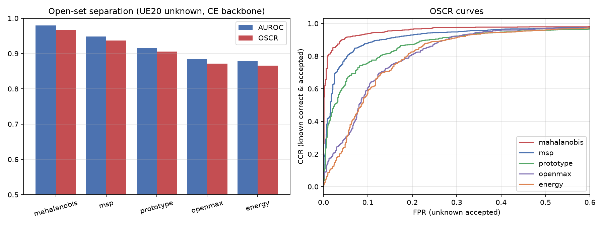

**读法**

- 马氏在**所有指标**上领先，且领先幅度不小（OSCR 比第二名高 2.9 个点）。
  它在 32 维 PCA + Ledoit-Wolf 收缩的空间里按类建模，比单点的原型余弦多利用了
  类内协方差方向，这正是 Yin et al. (TCCN 2024) 在 K 维头上用马氏的动机。
- 5 个打分器的**闭集**准确率完全相同（0.9795），因为 softmax 的头是共用的；
  马氏的 0.9830 来自它自己的最近类中心判决，属于打分器的一部分。
- Energy 在这里**不如** MSP。常见结论是能量分数更稳，但那是大规模预训练网络上的
  经验；本任务只有 7 类、logit 维度低，logsumexp 的动态范围被压缩，优势消失。
- OpenMax 的 TPR@FPR5 只有 0.3054，说明 Weibull 尾拟合在 480 条/类的样本量下不稳；
  它的均值判决（AUROC 0.88）尚可，但低误受率区间不能用。

---

## 3. 阈值工作点（马氏，95% 已知接受率）

| | 数值 |
|---|---:|
| 阈值 τ | −6.7457 |
| 已知接受率（val 标定） | 0.950 |
| 已知接受率（test 实际） | 0.9518 |
| 未知检出率 | 0.8862 |
| 已知"判对且被接受" | 0.9438 |
| 整体开集准确率 | 0.9198 |

各类的误拒率（被当成未知而拒绝）：

| 类 | UE9 | UE12 | UE17 | model1 | model2 | model5 | model9 |
|---|---:|---:|---:|---:|---:|---:|---:|
| 误拒率 | 2.5% | 8.8% | 3.1% | 8.8% | 5.6% | 4.4% | 0.6% |

model1（8.8%）与 UE12（8.8%）最难保留，model9 最稳（0.6%）。

---

## 4. 失败分析：UE20 去哪了

马氏判决下的 800 条 UE20：

| 结果 | 条数 | 占比 |
|---|---:|---:|
| 正确拒识 | 709 | 88.6% |
| 误判为 UE9 | **84** | 10.5% |
| 误判为 model2 | 4 | 0.5% |
| 误判为 UE12 | 3 | 0.4% |
| 误判为其他已知类 | 0 | 0% |

误受几乎全部 collapse 到 UE9 一个类上（84/91 = 92%）。这不是阈值问题——降阈值会
同时牺牲已知类——而是**表征上 UE20 与 UE9 确实重叠**。可行的改进方向是
按类自适应阈值（每类各自标定 τ_k），而不是全局单一 τ。

### 4.1 完整混淆矩阵（条数）

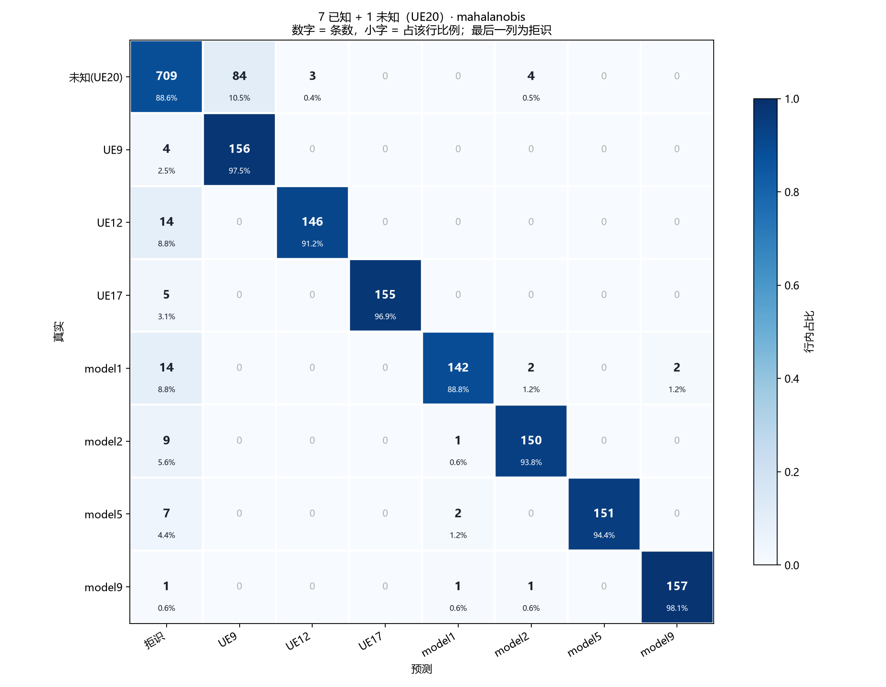

| 真实＼预测 | 拒识 | UE9 | UE12 | UE17 | model1 | model2 | model5 | model9 | 合计 |
|---|---:|---:|---:|---:|---:|---:|---:|---:|---:|
| 未知（UE20） | **709** | 84 | 3 | 0 | 0 | 4 | 0 | 0 | 800 |
| UE9 | 4 | **156** | 0 | 0 | 0 | 0 | 0 | 0 | 160 |
| UE12 | 14 | 0 | **146** | 0 | 0 | 0 | 0 | 0 | 160 |
| UE17 | 5 | 0 | 0 | **155** | 0 | 0 | 0 | 0 | 160 |
| model1 | 14 | 0 | 0 | 0 | **142** | 2 | 0 | 2 | 160 |
| model2 | 9 | 0 | 0 | 0 | 1 | **150** | 0 | 0 | 160 |
| model5 | 7 | 0 | 0 | 0 | 2 | 0 | **151** | 0 | 160 |
| model9 | 1 | 0 | 0 | 0 | 1 | 1 | 0 | **157** | 160 |

对角线 = 正确识别（或正确拒识）。已知类之间的混淆极少（每格 0–2 条），
误差几乎全部落在"拒识"这一列上，说明失效集中在开集边界而非闭集判别。

---

## 5. 留一设备未知（最关键的一组）

每次把一台设备整个抽出来当未知，用其余 6 台训练；阈值仍只在已知 val 上标定。
表内为马氏；括号内为该次运行里**最好**的打分器。

| 未知设备 | AUROC | OSCR | 该次最优打分器（按 OSCR） |
|---|---:|---:|---|
| UE9 | 0.8005 | 0.7883 | mahalanobis |
| model5 | 0.8575 | 0.8548 | mahalanobis |
| model1 | 0.9424 | 0.9356 | prototype (0.9406) |
| model9 | 0.9633 | 0.9488 | mahalanobis |
| UE12 | 0.9717 | 0.9431 | mahalanobis |
| **UE20（主协议）** | **0.9795** | **0.9661** | mahalanobis |
| model2 | 0.9833 | 0.9730 | mahalanobis |
| UE17 | 0.9876 | 0.9682 | mahalanobis |
| **均值（7 台留一）** | **0.9295** | **0.9160** | — |

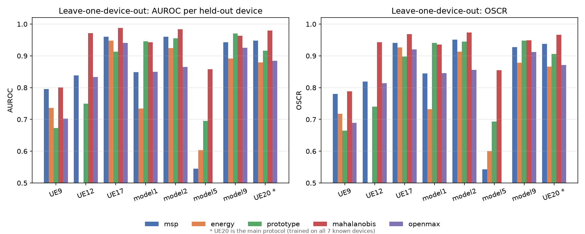

> 图中 `UE20 *` 为主协议（用全部 7 台已知设备训练），其余为严格留一，两者口径不同，仅作参照。

**读法**

- 难度跨度很大：**0.80（UE9）到 0.99（UE17）**，差 19 个点。
  只看 UE20 会高估方法的普适性。
- UE20 的 0.9795 **高于**留一均值 0.9295，排第 2。所以主协议的数字偏乐观而非偏悲观，
  但它仍落在真实分布内，不是异常值。
- UE9 最难：它是 2 m 目录里样本最多（10063 条）的一台，混入训练时模型对它的
  类内变化学得很细；一旦抽走，剩余 6 类学到的边界反而容不下它。
- 值得注意的是 model1 的最优打分器变成了 **prototype**，说明
  没有哪个打分器在所有未知设备上恒定最优——这也是不该只报单一配置的理由之一。

---

## 6. 损失消融（马氏打分器）

| 配置 | AUROC | OSCR | 闭集 Acc |
|---|---:|---:|---:|
| **CE（基线）** | 0.9795 | **0.9661** | **0.9830** |
| CE + SupCon (0.5) | **0.9801** | 0.9622 | 0.9786 |
| CE + maxmin (0.5) | 0.9679 | 0.9505 | 0.9777 |
| CosFace (s=16, m=0.2) | 0.9658 | 0.9494 | 0.9786 |

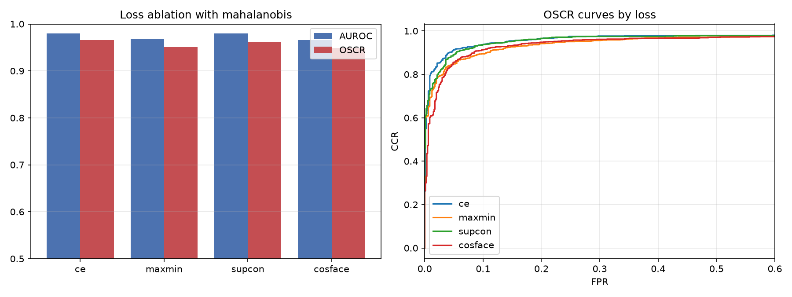

**读法**

- SupCon 的 AUROC 比 CE 高 0.0006（等于噪声），但 OSCR 低 0.39 个点——
  它在尾部把已知样本推得更开，却让一部分本该判对的样本落到了阈值外。
- maxmin 与 CosFace 都**同时**掉了 AUROC 和 OSCR。
  maxmin 的结果与 Yin et al. 自己的观察一致：作者报告加 maxmin 后未知检测变好，
  但已知分类从 98.45% 掉到 97.15%；我们这里连未知检测也没变好，说明
  该正则在 480 条/类、单会话的条件下不成立。
- 结论：**在这批数据上，开集性能的上限由表征（马氏 + 低维协方差）决定，
  不由损失函数决定。**

---

## 7. 与参考文献的对照

| | LTE MCCNN (TCCN'24) | GE-OSR (Drones'26) | 本工作 |
|---|---|---|---|
| 信号 | LTE PRACH | DJI OcuSync | 5G NR PRACH |
| 已知/未知 | 6 / 4 | 4 / 1–6 | 7 / 1 |
| 表征 | 三张 DCTF | IQ + FCTM + Conv-Transformer | 原始 IQ + 1D ResNet |
| 开集机制 | K 维马氏 | 类嵌入 + 自由能 | 低维马氏（PCA 32 + LW） |
| 开集损失 | maxmin | DCEL + FEAL | 均尝试，均未增益 |
| AUROC | 0.9817 | 0.9662 | 0.9795 |
| OSCR | — | 0.9598 | 0.9661 |

数字接近，但**不可直接比较**：他们的未知设备有 4–6 台、每台多个采集时段，
我们只有 1 台未知、单会话、按文件划分。我们的数字更可能是乐观上界。

---

## 8. 局限（必须写进论文）

1. **单会话**：每个 2 m 目录是一次连续采集，train/val/test 共享信道、增益与接收机状态。
   按文件划分无法排除"模型学到的是这次采集的信道"。
2. **只有 1 台未知设备**：主协议的 0.9795 只对 UE20 成立；留一实验给出 0.80–0.99 的区间。
3. **已知类身份 = 目录分组**，未核实物理机身。
4. **时序抖动 ±4 样点**（CP 平台导致），对统计型特征影响小，对波形形状特征是一层噪声。
5. **model\* 的距离是假设**（按 2 m 处理），文件内无记录。
6. **开场采集异常**：每个目录最前面约 30 条（`prach_1..30`）明显偏离总体——
   随机抽 50 条推理准确率 94–100%，但前 30 条仅 UE17 67%、model9 60%、model2 83%，
   且几乎全被拒识。这些文件只占全池约 **0.3%**（UE9 为 30/10063），
   不影响划分与结论，但**做在线演示时不要用它们**（我第一次演示恰好全挑中，
   结果看起来像模型失效）。

---

## 9. 特征分布可视化

用主协议模型（`outputs/main/ce_seed42`）的 128 维嵌入画三张图，脚本 `analysis/features.py`。

### 9.1 t-SNE

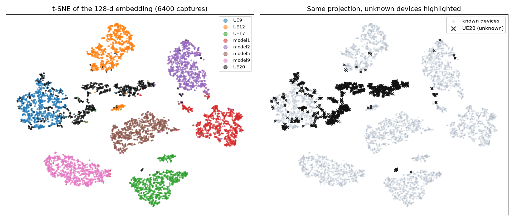

7 个已知设备各自成簇、彼此分离，闭集可分性一目了然。UE20（黑）**不是散在空白处**，
而是沿 UE9 簇的边缘铺开，并延伸到一条横跨中部的带状区域——这正是开集识别最怕的情形：
未知样本落在已知流形**内部**而不是外部。

> 注意：t-SNE 是在全部 6400 个点上拟合的，UE20 会轻微影响布局；它只用于定性观察，
> 定量结论看下面两张图。

### 9.2 类均值余弦相似度

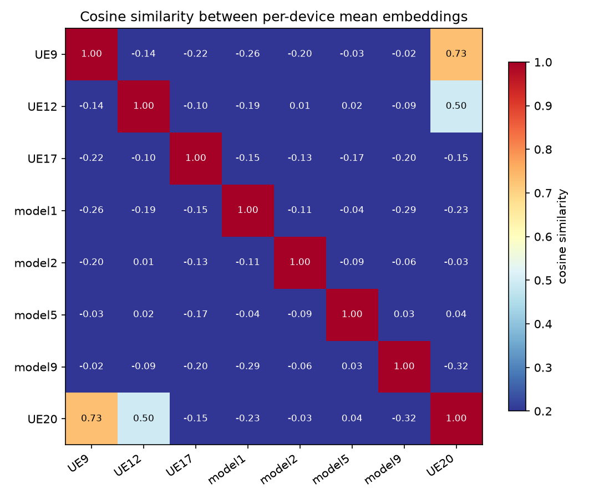

| 对 | 余弦相似度 |
|---|---:|
| UE20 ↔ **UE9** | **0.73** |
| UE20 ↔ UE12 | 0.50 |
| UE20 ↔ UE17 / model1 / model2 / model5 / model9 | −0.32 … 0.04 |
| 7 个已知类两两之间 | −0.29 … 0.03 |

已知类之间**几乎正交**（最大 0.03），说明骨干确实学到了互不重叠的 7 个方向；
而 UE20 的均值与 UE9 的夹角只有 43°，与 UE12 也有 0.50。这直接解释了第 4 节：
UE20 被接受时 84/91 判成 UE9，不是阈值没调好，而是它的表征**本来就在 UE9 的方向上**。

### 9.3 打分分布

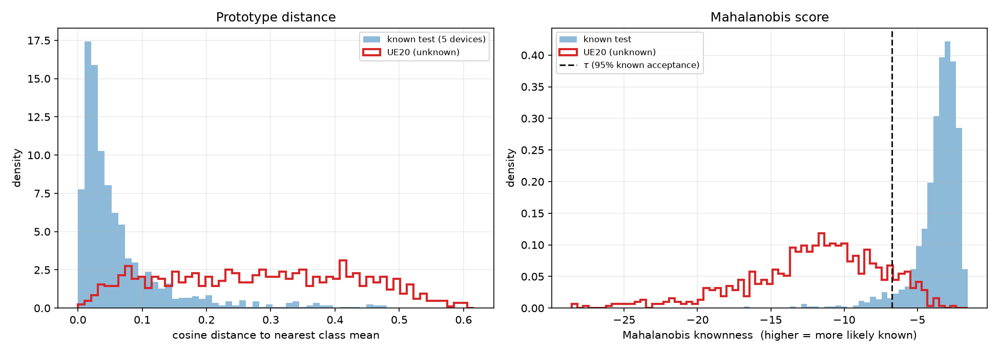

| | 已知 test | UE20 |
|---|---:|---:|
| 到最近类均值的余弦距离（中位） | 0.038 | 0.286 |
| 马氏 knownness 阈值 τ | −6.7459 | — |

左图：已知样本的余弦距离集中在 0.04 附近，UE20 铺到 0.3 以上，两者只在
0.05–0.15 的窄带重叠——原型打分器（AUROC 0.916）的能力边界就在这里。

右图：马氏把已知压成一个尖峰，未知的分布整体左移约 8 个单位，两峰重叠很小，
这就是它 AUROC 0.9795 的来源。但 UE20 有一个右尾穿过 τ，对应 11.4% 的误受。
**尾部的形状才是瓶颈**：把 τ 右移能多拒未知，但已知也会被拒（95% 工作点已经是折中）。

---

## 10. 跨距离测试：2 m 训练 → 4 m 测试

只有 UE9 / UE12 / UE17 有 4 m 目录（model\* 与 UE20 没有）。每台设备从 4 m 随机抽 200 条，
这 200 条从未进入训练。

| 设备 | 2 m 准确率 | **4 m 准确率** | 2 m 接受率 | 4 m 接受率 | 4 m 中位 knownness | 4 m 主要误判去向 |
|---|---:|---:|---:|---:|---:|---|
| UE9 | 99.5% | **0.0%** | 97.0% | 56.5% | −6.51 | model2 ×187, model1 ×9 |
| UE12 | 99.0% | **11.0%** | 91.5% | 56.5% | −5.70 | UE17 ×125, model2 ×48 |
| UE17 | 98.0% | **23.5%** | 95.0% | 21.0% | −8.98 | UE9 ×110, UE12 ×43 |

**准确率塌到接近或低于随机（1/7 = 14%），而且错得很自信。** 这是本工作最重要的负面结果。

### 10.1 先排除了预处理

| 设备 | cp_corr 2m/4m | 重复块相干 2m/4m | body RMS 2m/4m |
|---|---|---|---|
| UE9 | 0.986 / 0.941 | 0.988 / 0.945 | 29.6 / 13.6 |
| UE12 | 0.997 / 0.983 | 0.997 / 0.983 | 63.3 / 24.8 |
| UE17 | 0.987 / 0.981 | 0.991 / 0.985 | 35.9 / 26.9 |

4 m 的信号确实弱（RMS 约为 2 m 的 1/2，符合自由空间距离翻倍、幅度减半），但
CP 相干度仍在 0.94–0.98，远高于 0.81 采集门限，同步抖动与 2 m 同级。
**不是同步失败，也不是前导配置变化**——前导根分布在 2 m / 4 m 之间一致（都覆盖 1..8）。

### 10.2 模型对信噪比极其脆弱

对 2 m 测试样本注入白噪声（信号已 RMS 归一，故 SNR 可直接设定），每档 100 条：

| SNR | UE9 | UE12 | UE17 |
|---|---:|---:|---:|
| 30 dB | 0.99 | 0.98 | 1.00 |
| 25 dB | 0.69 | 0.40 | 0.98 |
| 20 dB | 0.00 | 0.84 | 0.00 |
| 15 dB | 0.00 | 0.00 | 0.00 |
| 10 dB | 0.00 | 0.00 | 0.00 |

**只要掉 5–10 dB，闭集分类就基本失效**；而且不是随机退化——噪声把样本推向
`model1` / `model2` 两个模组类的方向（≤12 dB 时 100% 判成 model1）。
UE12 在 20 dB 反弹到 0.84 属于不稳定，不是恢复。

结论：**当前 98% 的闭集准确率强依赖 2 m 这一特定工作点，学到的不是纯硬件指纹，
而是与信噪比/信道质量纠缠的表征。** 这也解释了为什么留一设备实验（0.80–0.99）
看起来很稳——它们全都在 2 m 同一条件下，根本没测到这个失效轴。

### 10.3 一个失败的补救尝试

把训练增强的噪声从 σ=0.02（≈34 dB）加到 σ=0.20（≈14 dB）重训：
验证准确率最高只有 29%，早停在第 14 轮，闭集 **50.7%**、OSCR 0.756。

**暴力加噪不可行**——它把可分的指纹也一起淹掉了。可行的方向是：
多 SNR 课程学习（由易到难）、把 SNR 作为显式条件输入、或改用对增益/噪声不变的
物理量（I/Q 失衡、非圆性）而非原始波形。这一条需要单独实验，本工作尚未做。

---

## 11. 关键警告：设备类别与采集条件混淆

数据提供者确认：四台 `model*` 模组是**约 1 m** 处采集的，四台手机是 **2 m**。
也就是说，"设备类别"和"采集距离 / 接收增益 / 信噪比"在数据里是**混在一起的**。

### 11.1 各设备的信噪比并不一致

用同步窗外的静默段估计噪声功率（中位数估计，抗突发），得到每条记录的 SNR：

| 设备 | SNR 中位 | p10 – p90 |
|---|---:|---|
| UE9 | 21.1 dB | 20.2 – 22.0 |
| UE12 | 28.2 dB | 19.1 – 29.6 |
| UE17 | 20.4 dB | 18.5 – 22.9 |
| UE20 | 19.1 dB | 14.5 – 24.4 |
| model1 | 20.9 dB | 17.5 – 25.4 |
| model2 | 15.5 dB | 14.9 – 16.2 |
| model5 | 24.4 dB | 20.6 – 24.5 |
| model9 | 17.0 dB | 16.8 – 17.1 |

注意模组的 SNR 反而**更低**（中位 17.1 vs 手机 21.3）——所以不是简单的"近=强"，
更可能是不同采集场次用了不同的接收增益/前端。无论如何，**采集条件与类别强相关**。

### 11.2 不看波形能认出多少？

只用 4 个与指纹无关的粗物理量（SNR、对数 RMS、|CFO|、CP 相干度），5 折交叉验证：

| 任务 | 特征 | 准确率 |
|---|---|---:|
| 7 类设备识别 | 4 个物理量 | **79.9%** |
| 7 类设备识别 | **仅 SNR** | **51.1%** |
| 手机 vs 模组 | 4 个物理量 | 77.4% |
| 手机 vs 模组 | **仅 SNR** | **64.2%** |

随机基线分别是 14.3% 和 50%。**单个标量 SNR 就能把 7 分类做到 51.1%（3.6 倍随机）**，
四个标量做到 79.9%——完全不需要看 I/Q 波形。

### 11.3 这对结论意味着什么

- 深度模型报的 **98.3%** 必须与 **79.9% 的无波形基线**放在一起读，它的"净增量"约 18 个点，
  而不是相对随机基线的 84 个点。
- 第 10 节的 4m 崩溃也说得通了：模型倚重的是被采集条件塑造的那部分表征，
  换个距离整套映射就失效。
- 留一设备实验（0.80–0.99）同样受影响：被留出的设备与其他设备在 SNR 上仍然可分，
  所以这些数字衡量的是"在固定采集条件下能否认出新设备"，不是"能否抗住条件变化"。

### 11.4 该怎么补

1. **同距离采集**：所有设备在相同距离、相同增益下重采，这是唯一能干净分离"设备"与"条件"的做法。
2. **条件匹配评测**：按 SNR 分层评估，或报告"控制 SNR 后"的准确率。
3. **条件不变表征**：对抗去除 SNR 分量、或用对增益/噪声不变的物理量（I/Q 失衡、非圆性）。
4. **论文写法**：把 79.9% / 51.1% 作为必须超越的基线明确列出，否则 98% 会被审稿人质疑。

---

## 12. 5 已知 / 3 未知协议

把未知从 1 台扩到 3 台：**未知 = UE20 + model5 + model9**，
**已知 = UE9 / UE12 / UE17 / model1 / model2**（5 类）。
选择理由：未知里含 1 台手机 + 2 个模组，类别不偏；移出训练的是两个最小的类，
数据损失最小。每台未知仍取 800 条（未知共 2400 条）。

| 协议 | 已知 / 未知 | 闭集 Acc | AUROC | OSCR | EER | FPR@95 | 总未知检出率 |
|---|---|---:|---:|---:|---:|---:|---:|
| 7 + 1 | UE20 | 0.9830 | **0.9795** | **0.9661** | 0.072 | 0.108 | **0.8862** |
| 5 + 3 | UE20, model5, model9 | 0.9912 | 0.8675 | 0.8642 | 0.225 | 0.452 | **0.4842** |

闭集反而更好（类别从 7 减到 5），但开集指标大幅下降。

### 12.1 关键：下降不是均匀的

| 未知设备 | 7+1 拒识率 | 5+3 拒识率 |
|---|---:|---:|
| UE20 | 0.886 | **0.876** |
| model9 | — | 0.544 |
| model5 | — | **0.033** |

**UE20 几乎没变（0.886 → 0.876）**，model9 掉到 0.54，而 **model5 只有 3.3%**
——800 条 model5 里 773 条被当成已知设备接受。

误受去向高度集中：2400 条未知中 1018 条判成 **model1**、134 条判成 model2、
86 条判成 UE12（UE20 的老毛病）。即 **model5 与 model9 基本被吞进了 model1**。

### 12.2 为什么会这样

已知模组只剩 model1 和 model2 两个，模组类的"占位"变少；model5 与 model1 在嵌入空间里
本来就靠得近（第 9.2 节相似度矩阵中二者 0.03，而其余已知类之间几乎正交，
说明这个方向从没被拉开）。**未知类若恰好落在两个已知模组之间，几何类开集机制没有理由
拒绝它**——马氏只惩罚"离所有类都远"，不惩罚"离某个类很近"。

这也再次说明：7+1 的 0.9795 是被 UE20 一台设备"选中"出来的乐观值，
换一批未知设备，同一套方法的 OSCR 会掉 10 个点以上。

### 12.3 特征空间证据

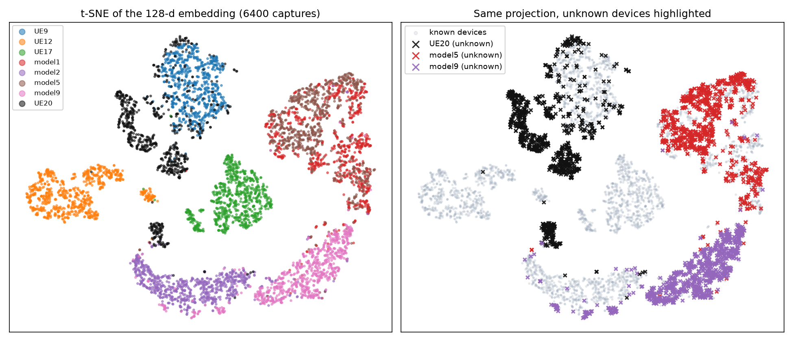

左图里 model5（棕）与 model1（红）**完全重叠成一团**；model9（粉）与 model2（紫）
在下方弧上相邻。右图把三台未知设备标出来，可以看到它们不是落在空白处，
而是**直接压在被当作已知的模组上**。

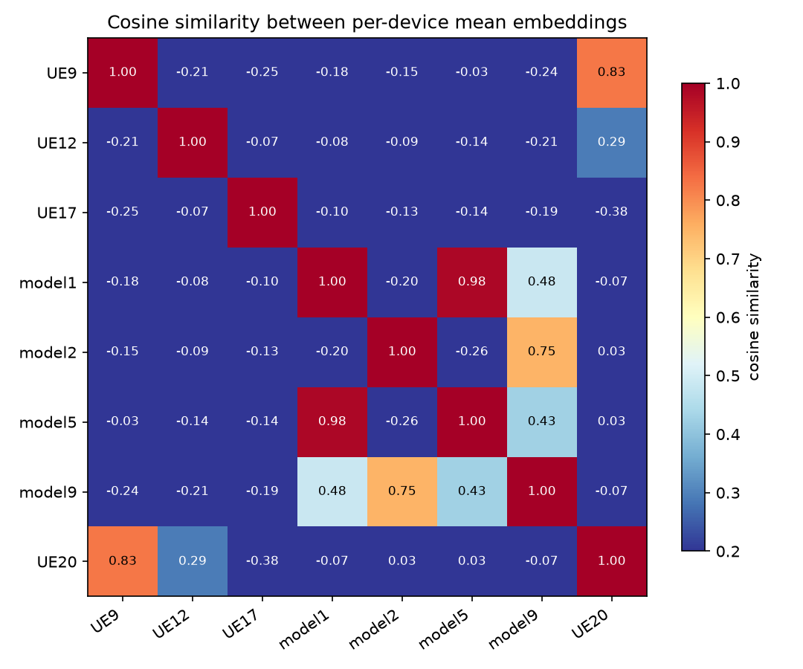

| 均值嵌入余弦相似度 | 7+1 模型 | 5+3 模型 |
|---|---:|---:|
| model1 ↔ model5 | 0.03 | **0.98** |
| model2 ↔ model9 | 0.03 | 0.75 |
| UE20 ↔ UE9 | 0.73 | 0.83 |

**这是本节最重要的一张表。** 7+1 模型里已知类之间"几乎正交"（最大 0.03）不是信号的
内在属性，而是 CE 在 7 个类上训练出来的划分；一旦 model5 / model9 退出训练集，
它们立刻塌到最近的已知模组上，相似度从 0.03 跳到 0.98。

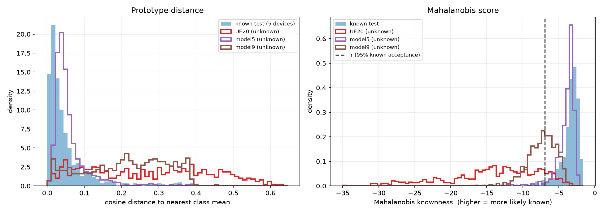

打分分布同样分裂：model5 的 knownness 主峰与已知类几乎重合（中位余弦距离 0.045，
已知类 0.029），所以 96.7% 被接受；model9 落在中间（距离 0.224，拒识 54%）；
UE20 明显在左（距离 0.280，拒识 88%）。

### 12.4 混淆矩阵（条数）

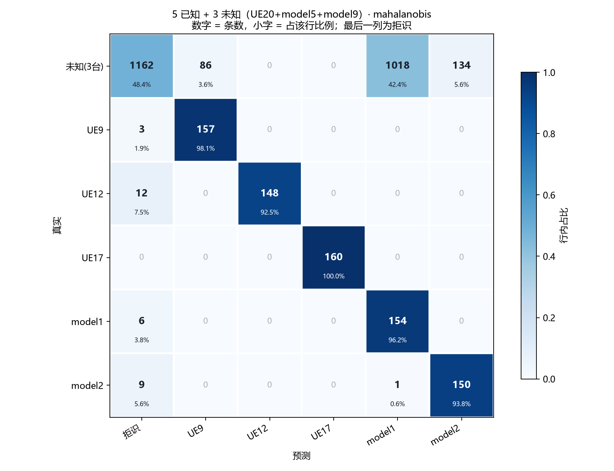

| 真实＼预测 | 拒识 | UE9 | UE12 | UE17 | model1 | model2 | 合计 |
|---|---:|---:|---:|---:|---:|---:|---:|
| 未知（3 台） | **1162** | 86 | 0 | 0 | **1018** | 134 | 2400 |
| UE9 | 3 | **157** | 0 | 0 | 0 | 0 | 160 |
| UE12 | 12 | 0 | **148** | 0 | 0 | 0 | 160 |
| UE17 | 0 | 0 | 0 | **160** | 0 | 0 | 160 |
| model1 | 6 | 0 | 0 | 0 | **154** | 0 | 160 |
| model2 | 9 | 0 | 0 | 0 | 1 | **150** | 160 |

已知类本身的识别几乎不受影响（UE17 160/160、model1 154/160、UE9 157/160），
流失的 1238 条全部是"把未知放进已知格子"，其中 **1018 条进了 model1**。
与 7+1 相比多出来的错误，几乎全在未知行，而不是已知行。

### 12.5 对论文的启示

- 未知设备难度差异极大（3% – 88%），**必须逐台报告**，只报总体均值会误导。
- "开集能力"在这里高度依赖未知类与已知类的几何关系，不是一个稳定的方法属性。
- 若要声称通用性，至少需要 3–4 台未知并逐台报告（TCCN'24 用 4 台未知，
  Drones'26 扫 1–6 台），这正是常见做法。

---

## 13. 产物索引

| 路径 | 内容 |
|---|---|
| `outputs/main/ce_seed42/results.json` | 主实验全部指标、混淆矩阵、OSCR 曲线 |
| `outputs/lodo/*/results.json` | 7 次留一设备 |
| `outputs/losses/*/results.json` | 3 个损失变体 |
| `outputs/summary.csv` | 全部运行 × 打分器的长表 |
| `outputs/eval_pool_2m.json`、`outputs/eval_pool_4m.json` | 每设备抽检结果 |
| `outputs/snr_robustness.json` | SNR 扫描曲线数据 |
| `outputs/confound_analysis.json` | 各设备 SNR 分布与无波形基线 |
| `outputs/figures/*.png` | 打分器对比、留一设备、损失消融、混淆矩阵、t-SNE、类相似度、打分分布 |
| `data/splits/open_set_2m_balanced_seed42/` | 划分清单 + summary.json |
| `data/cache/` | 预处理张量缓存 + 逐条元数据 |

单次运行细节（含失败模式）用：

```bash
python -m analysis.report outputs/main/ce_seed42
python -m analysis.features --run outputs/main/ce_seed42   # 特征分布图
```
